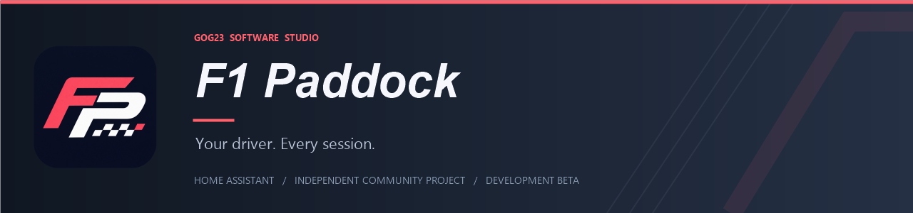
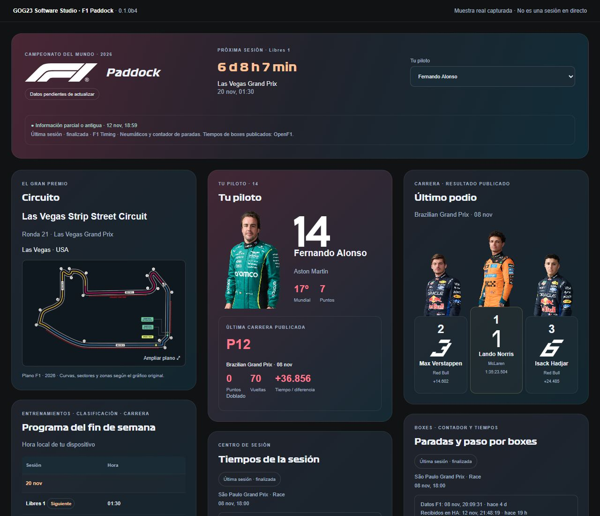
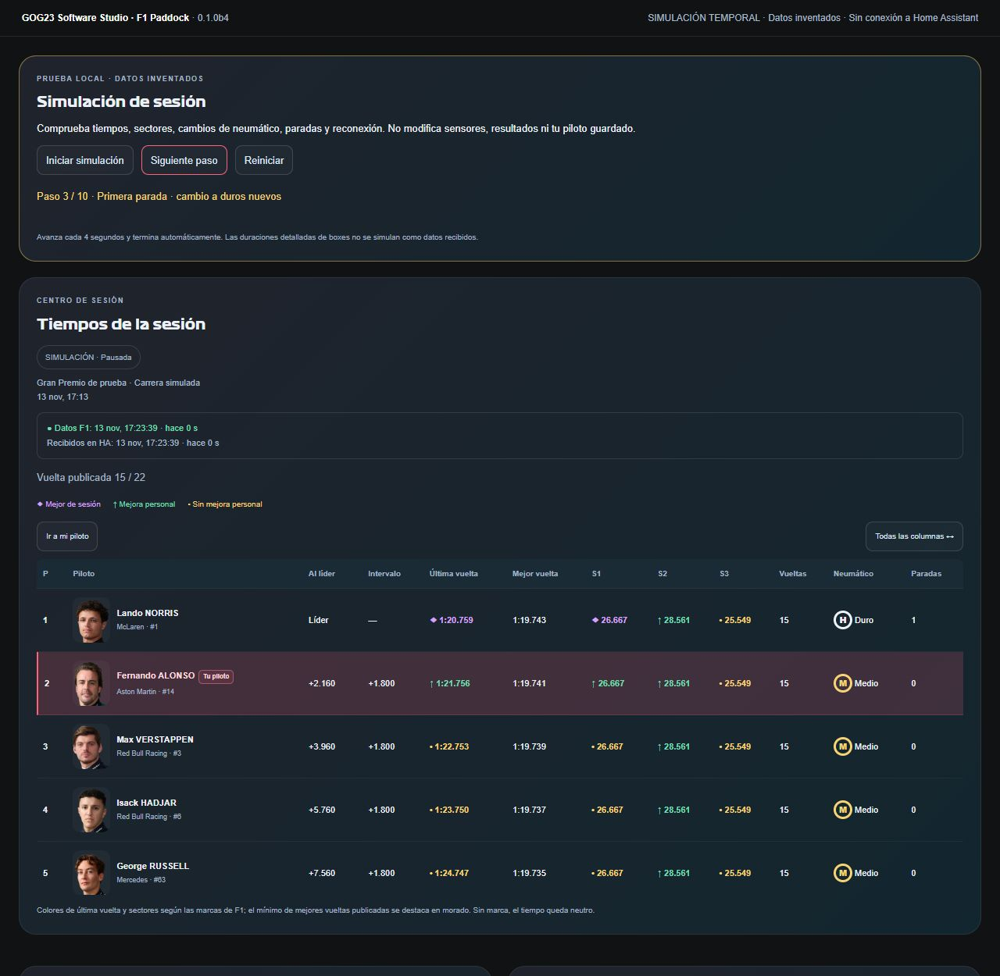

# F1 Paddock

**English** · [🇪🇸 Leer en castellano](#castellano)

A project by [GOG23 Software Studio](https://github.com/GOG23-Software-Studio) · Maintained by [@oyogor1985](https://github.com/oyogor1985)

[Installation](#installation) · [Independent cards](#independent-cards) · [Screenshots](#screenshots) · [How it works](#how-it-works) · [Issues](https://github.com/GOG23-Software-Studio/f1-paddock/issues)

**Development beta 0.1.0b6 · public repository · Marketplace catalogue submission pending.**

[](https://github.com/GOG23-Software-Studio/f1-paddock/actions/workflows/validate.yml)
[](https://my.home-assistant.io/redirect/marketplace_repository/?owner=GOG23-Software-Studio&repository=f1-paddock&category=integration)

The installation button adds this repository by link while catalogue review is pending; it does not indicate catalogue acceptance.

A Home Assistant integration with twelve independent dashboard cards and an optional complete panel, following the visual style of MotoGP Paddock. Choose your favorite driver to follow their portrait, race number, team, championship position and session timing. The bundled cards register automatically; no separate frontend download is required.

> **Third-party permissions remain unresolved.** The project uses official F1 fonts, photographs, number artwork, circuit maps and data services. The original FP project logo does not grant rights to these resources. Read the [publication review](PUBLICATION_REVIEW.md) and [data notices](custom_components/f1_paddock/DATA_LICENSE.md). This is an independent community project, with no official Formula 1 affiliation or endorsement.

## Included

- Race calendar, full weekend programme, local session times and next-session countdown.
- Enlargable circuit maps retaining the corners, sectors and zones shown in the original artwork.
- Persistent favorite-driver and results-GP selectors.
- Driver portraits, verified race-number artwork, teams, championship positions and points.
- Photographic 2–1–3 podium for the latest published race, independent of the selected results GP.
- Driver and constructor standings; race, Q1/Q2/Q3 qualifying and sprint results when published.
- Session timing, sectors, laps, tyre compounds and stints, plus pit-stop counts from the public F1 SignalR feed.
- Detailed stopped time and pit-lane duration from OpenF1 after the session; these are not live stop durations.
- Favorite-row highlighting, face-focused table portraits, sticky identity columns and expandable tables.
- Purple, green and yellow timing marks based on explicit provider flags; missing flags remain neutral.
- Separate timestamps for the sporting data and HA timing reception. Connection heartbeats do not make old timing look fresh.
- Incremental table updates preserving DOM nodes, focus and scroll position.
- A shared coordinator and cache: adding cards does not multiply provider requests.
- A local fictional simulation for testing updates, tyres, stops, colors and driver reordering without writing to HA.

This beta does not include animated track positions, Race Control, championship evolution or points-by-GP cards. Real live-session validation remains pending. Season selection is manual; there is no automatic year rollover or persistent season archive.

## How it works

Jolpica supplies calendars, standings and published results. Requests are spaced at least 1.1 seconds apart; calendars are cached for six hours and standings/results for fifteen minutes. The coordinator checks every five minutes, reuses cached data and backs off on errors and rate limits.

A shared public F1 SignalR connection supplies available session timing. No account credentials or F1TV-only streams are requested. Outside session windows, the last reading is retained and checked every five minutes; around sessions the client listens for updates. An active session and recent data are required for the live label. A finished session is never relabelled live because HA just fetched it. Public accessibility does not establish reuse permission.

Photos and maps load from their original remote servers. F1 Bold is fetched once and cached locally by HA; a system font is used if it fails. Internet is required. Large dashboard attributes are excluded from Recorder. The integration creates no automations, notifications or device controls. See [sources](SOURCES.md) and [validation](VALIDATION.md).

## Installation

### Marketplace / HACS

The repository is public. [Catalogue submission #14100](https://github.com/hacs/default/pull/14100) is pending review, so being on GitHub does not yet make it searchable in the general catalogue.

1. In Home Assistant 2026.11 or later, open **Settings → Marketplace → Add from link** and connect GitHub if prompted.
2. Add `https://github.com/GOG23-Software-Studio/f1-paddock`.
3. Enable **Pre-release** on the repository's device page to install this beta; that entity may initially be disabled.
4. Install F1 Paddock, restart HA and reload the browser/app.
5. On first installation, add **F1 Paddock** from **Settings → Devices & services → Add integration**. Choose the season and driver.

For older HACS installations, add the same URL under **Custom repositories**, category **Integration**, and select the pre-release. Marketplace/HACS installs the tagged component source, not the manual ZIP attached to the release.

### Local installation

Download [release 0.1.0b6](https://github.com/GOG23-Software-Studio/f1-paddock/releases/tag/0.1.0b6) and use **f1-paddock-0.1.0b6.zip**. The “Source code” downloads contain the whole repository.

1. Back up your configuration.
2. Extract the ZIP and copy only `custom_components/f1_paddock` into HA's `/config/custom_components/`.
3. Restart Home Assistant.
4. Add **F1 Paddock** from **Settings → Devices & services → Add integration**, then choose the season and driver.
5. Reload the browser/app. Open **Edit dashboard → Add card → By card**, search **F1 Paddock** and select the actual Dashboard sensor created by your installation.

```yaml
type: custom:f1-paddock-card
entity: sensor.f1_paddock_dashboard
table_height: 430
```

Entity IDs are examples. Related selectors are discovered through HA's entity registry; `favorite_entity` and `round_entity` can be supplied manually. No `button-card`, `card-mod` or household helpers are required.

## Independent cards

Use the complete dashboard or add any of these twelve blocks separately from HA's card picker. All share the same sensor, coordinator and favorite selection.

| Card | Type |
| --- | --- |
| Complete dashboard | `custom:f1-paddock-card` |
| Next session | `custom:f1-paddock-next-card` |
| Circuit | `custom:f1-paddock-circuit-card` |
| Weekend programme | `custom:f1-paddock-programme-card` |
| Favorite driver | `custom:f1-paddock-driver-card` |
| Latest race podium | `custom:f1-paddock-podium-card` |
| Driver standings | `custom:f1-paddock-standings-card` |
| Constructor standings | `custom:f1-paddock-constructors-card` |
| Results | `custom:f1-paddock-results-card` |
| Calendar | `custom:f1-paddock-calendar-card` |
| Session timing | `custom:f1-paddock-timing-card` |
| Tyres and stints | `custom:f1-paddock-tyres-card` |
| Pit stops | `custom:f1-paddock-pits-card` |

Use HA's visual editor and Sections layout to resize and position blocks. [Sections example](examples/sections-view.yaml): replace its example entity ID before importing it. It does not replace an existing dashboard.

## Screenshots

### Complete dashboard



Local preview with dated sporting data, not a live session. The age warning belongs to that sample. No household dashboard navigation or private configuration is shown.

### Timing, colors and favorite driver



Clearly labelled **fictional simulation** used to demonstrate colors, favorite highlighting and table layout. It is not evidence of real race-day operation. Screenshots contain third-party artwork whose permissions remain under review; it is not covered by the code's MIT license.

## Updating an existing installation

1. Back up the component and HA configuration.
2. Update through Marketplace/HACS, or replace only `/config/custom_components/f1_paddock` using the new manual installer.
3. Keep the existing integration entry to preserve its entities, selected driver and results GP.
4. Restart HA and reload each browser/app. The integration registers its bundled card resource automatically; do not install a second copy of the cards.

If an update fails, restore the previous component from your backup and restart. No HA installation is changed by cloning this repository or opening the local preview.

## Data and media

The 2026 asset audit identified 23 circuit maps and 22 current official driver portraits/number graphics. Esteban Ocon, Yuki Tsunoda and Ryo Hirakawa have no matching assets in that audited directory; their names and numbers appear as text. Other drivers' artwork is never substituted. URL/circuit identity checks do not amount to a full visual review: the Las Vegas map and number set were inspected visually; the other 22 maps still need individual visual review before a stable release.

Jolpica data is attributed separately under its noncommercial CC BY-NC-SA terms. OpenF1 historical pit information and the direct F1 timing feed have their own conditions. The code's MIT license does not license provider data, photographs, fonts, race-number designs, maps, logos or trademarks. See [third-party notices](THIRD_PARTY_NOTICES.md), [data license](custom_components/f1_paddock/DATA_LICENSE.md), [fixture attribution](tests/fixtures/README.md) and [publication review](PUBLICATION_REVIEW.md).

## Validation

Installation and basic operation were checked on HA OS / Core 2026.11.1: seven entities, automatic resource registration, locally served font, favorite selection and GP results. Simulation checks cover timing/tyre/pit updates, colors, reordering and retained page position. **Validation during an actual live sporting session is still pending.**

[HACS, hassfest and packaging validation](https://github.com/GOG23-Software-Studio/f1-paddock/actions/runs/43470052377) passed without ignored checks before release 0.1.0b6. Technical validation does not establish third-party usage rights. See [validation notes](VALIDATION.md).

## Development

Python 3.14 with Home Assistant 2026.11.1, aiohttp, pytest, pytest-asyncio and ruff; Node with jsdom for frontend tests. Install development dependencies in an isolated environment. From the repository root:

```text
python -m pytest
python -m ruff check custom_components tests tools
npm install --ignore-scripts
npm test
python tools/package_release.py --tag 0.1.0b6
python -m unittest discover -s tests -p packaging_checks.py
```

The standard-library packager requires neither HA nor network access. It builds a deterministic manual installer and SHA256 file in `dist/`, excluding local caches and private files. Tags must match the manifest and runtime version exactly. The release workflow builds and attaches the installer from the published tag.

`tools/audit_sources.py`, `tools/check_assets.py` and `tools/check_official_drivers.py` contact public sources and record audit evidence. `tools/build.py` generates examples, a normalized snapshot and the installer. `tools/serve_preview.py` serves a dated local sample, using ignored `.local/assets` files; it never connects to HA. A fresh clone does not include that private preview cache or snapshot.

### Local simulation and table behavior

```yaml
type: custom:f1-paddock-card
entity: sensor.f1_paddock_dashboard
card_type: simulation
table_height: 430
```

The simulation copies received drivers and generates fictional data only in the browser, without sensor writes or service calls. It runs ten steps every four seconds, with pause, step and reset controls. It simulates sectors, tyres, stops, driver ordering, signal loss and recovery, stops automatically and clears its timer when the view is left. No permanent test tab is required.

Favorite rows use a highlighted background, a badge and `aria-current`. Explicit `OverallFastest` / `PersonalFastest` flags control purple (session best), green (personal improvement) and yellow (no personal improvement) sectors and last laps. Missing flags remain neutral; sectors from different laps are not combined into invented records. The best-lap column highlights the lowest valid published best lap. Table portraits use a 48 × 58 px face crop; large cards retain full photographs.

## Publication status

The owner authorized public publication and Marketplace submission. [Request #14100](https://github.com/hacs/default/pull/14100) remains subject to maintainer review; inclusion and timing are not guaranteed. Third-party permissions and real live-session validation remain open, as documented above. The project remains a pre-release.

## Support and contribution

Report reproducible bugs or feature suggestions through [Issues](https://github.com/GOG23-Software-Studio/f1-paddock/issues). Include the HA version and affected session; never post credentials, private URLs or household configuration.

See the [contribution guide](CONTRIBUTING.md) for checks and reporting guidance.

Original code is licensed under [MIT](LICENSE). Third-party media and data rights are separate. This project has no official Formula 1 affiliation or endorsement.

## Support this project

F1 Paddock is free. If you find it useful and would like to support my development time, you can [buy me a coffee](https://www.buymeacoffee.com/oyogor). Support is optional and does not unlock features.

<a href="https://www.buymeacoffee.com/oyogor" target="_blank" rel="noopener noreferrer"></a>

<a id="castellano"></a>

## Castellano

[Back to English](#f1-paddock)

Beta funcional de GOG23 Software Studio. Una integración propia de Home Assistant y doce tarjetas independientes, más un panel completo, con el estilo de MotoGP Paddock.

Incluye la tipografía F1 Bold, fotografías actuales, gráficos oficiales de dorsales y planos detallados originales con sus zonas. Son recursos de terceros servidos por Formula1.com; el proyecto no es una integración oficial de Formula 1.

> **Permisos de terceros pendientes:** la revisión ha identificado recursos oficiales y permisos de datos pendientes. Consulta [la revisión previa](PUBLICATION_REVIEW.md). El logo FP propio ya está incluido; esto no autoriza los recursos de terceros.

### Descarga y estado

[Descargar la release 0.1.0b6](https://github.com/GOG23-Software-Studio/f1-paddock/releases/tag/0.1.0b6). Utiliza el archivo **f1-paddock-0.1.0b6.zip** de los adjuntos; los archivos «Source code» son el repositorio completo.

Es una integración instalable, con configuración, entidades y tarjetas incluidas. Se distribuye como **pre-release**: la instalación, los datos publicados y la simulación están comprobados; falta validar el flujo durante una sesión deportiva real. Los tiempos detallados de boxes llegan después de la sesión. El repositorio es público y está preparado para Marketplace/HACS. La [solicitud de inclusión en el catálogo general #14100](https://github.com/hacs/default/pull/14100) está pendiente de revisión.

### Capturas

Vista general con una muestra deportiva capturada; no es una sesión en directo. El aviso de antigüedad corresponde a esa muestra. No se muestra el panel ni información doméstica de ninguna instalación.


Tiempos, sectores y piloto favorito en una **simulación con datos inventados**. Sirve para mostrar los colores y el diseño; no acredita funcionamiento en carrera.


### Qué funciona

- Calendario y programa completo del GP, con horarios locales y cuenta atrás de la próxima sesión.
- Plano ampliable: conserva curvas, sectores y zonas presentes en el gráfico original de la temporada.
- Selector persistente de cualquier piloto publicado en el campeonato.
- Foto, dorsal gráfico verificado, equipo, posición del Mundial, puntos y última carrera del piloto.
- Podio fotográfico 2–1–3 de la última carrera publicada, independiente del GP elegido en resultados.
- Mundial completo de pilotos y constructores.
- Resultados por GP: carrera, clasificación con Q1/Q2/Q3 y sprint cuando la fuente lo publique.
- Tablas con desplazamiento, ampliación de columnas y acceso a la fila del favorito.
- Panel completo adaptable a móvil; las doce tarjetas también pueden colocarse individualmente con el editor visual de HA.
- Un coordinador y una caché compartida: añadir tarjetas no multiplica las consultas.
- Registro automático del recurso de las tarjetas. No necesita button-card, card-mod ni ayudantes domésticos.

### Límites de esta primera beta

Incluye tiempos de sesión, sectores, vueltas, neumáticos y tandas, y el contador de paradas mediante el flujo público F1 SignalR. Los tiempos detallados de boxes se consultan en OpenF1 después de la sesión y se separan en tiempo detenido y tiempo de paso por el pit lane. No incluye tiempos detallados de paradas en directo, posiciones animadas, Race Control, evolución del Mundial ni puntos por GP. El indicador de directo exige una sesión activa y datos recientes; una lectura de una sesión finalizada nunca se presenta como directo.

El índice estático consultado en la primera beta devolvió HTTP 401. En beta 2 se ha verificado el servicio público SignalR Core, que negocia la conexión sin cuenta. Solo se solicitan flujos públicos: no se introducen credenciales ni se solicitan flujos reservados a F1TV. El cliente comparte una conexión y espera entre reintentos. Fuera de las ventanas de sesión se conserva la última lectura y se revisa cada cinco minutos; cerca de las sesiones permanece atento al flujo.

Los recursos visuales se han comprobado para **2026**: 23 mapas y 22 fotos/dorsales del directorio oficial actual. Los tres pilotos que aparecen en el campeonato pero no en ese directorio son Esteban Ocon, Yuki Tsunoda y Ryo Hirakawa: se muestran sus nombres y números sin sustituirlos por gráficos ajenos. Las imágenes de otra temporada no se reutilizan automáticamente. La comprobación de mapas confirma la URL y la identidad del circuito; el plano de Las Vegas y el conjunto de dorsales se han inspeccionado visualmente. Los otros 22 mapas requieren revisión visual individual antes de una publicación estable.

La temporada se elige al instalar; esta beta no cambia de año automáticamente. El catálogo de pilotos requiere que ya existan clasificaciones publicadas. La preferencia y el GP seleccionado se conservan en HA; la caché de datos todavía es de memoria y no constituye un archivo permanente.

### Instalación y actualización desde Marketplace

El repositorio es público. La inclusión en el catálogo general está pendiente de revisión; publicarlo en GitHub no lo incorpora automáticamente al buscador.

1. En Home Assistant 2026.11 o posterior, abre **Ajustes → Marketplace → Añadir desde enlace** y conecta GitHub si se solicita.
2. Añade `https://github.com/GOG23-Software-Studio/f1-paddock`.
3. Activa **Pre-release** en la página del dispositivo del repositorio para instalar esta beta; esa entidad puede estar deshabilitada inicialmente.
4. Instala F1 Paddock, reinicia Home Assistant y recarga el navegador o la aplicación.
5. En la primera instalación, añade **F1 Paddock** desde **Ajustes → Dispositivos y servicios**. Si ya estaba instalada manualmente, conserva la integración y sus entidades.

En instalaciones anteriores con HACS, añade el mismo enlace desde **Repositorios personalizados**, categoría **Integración**, y selecciona la pre-release.

Las actualizaciones se ofrecen mediante la entidad de actualización del repositorio. Guarda una copia de seguridad antes de actualizar, reinicia HA y recarga el navegador. Se conservan el dominio `f1_paddock` y las preferencias.

Marketplace/HACS instala `custom_components/f1_paddock` desde la etiqueta publicada, sin utilizar el ZIP manual adjunto. No instales una segunda copia de las tarjetas.

Documentación: [Marketplace](https://www.home-assistant.io/integrations/marketplace/) y [proceso de inclusión en el catálogo](https://contributors.home-assistant.io/marketplace/guides/catalog/).

### Instalación manual en Home Assistant

Paquete: `dist/f1-paddock-0.1.0b6.zip`.

1. Guarda una copia de seguridad de tu configuración.
2. Extrae el ZIP y copia **solo** `custom_components/f1_paddock` dentro de `/config/custom_components/`.
3. Reinicia Home Assistant cuando te venga bien.
4. En **Ajustes → Dispositivos y servicios → Añadir integración**, busca **F1 Paddock**.
5. Elige temporada y piloto. Los cambios posteriores de piloto no consultan Internet.
6. Recarga el navegador o la aplicación para que aparezcan las tarjetas.
7. En el panel, usa **Añadir tarjeta → Por tarjeta** y busca **F1 Paddock**. Elige el sensor Dashboard real creado por tu instalación.

La instalación y el funcionamiento básico se han comprobado en Home Assistant OS con Core 2026.11.1: siete entidades, registro automático del recurso, fuente local, cambio de piloto y resultados por GP. La verificación de tiempos en una sesión real de carrera sigue pendiente.

Ejemplo mínimo — adapta el ID si HA crea otro:

```yaml
type: custom:f1-paddock-card
entity: sensor.f1_paddock_dashboard
table_height: 430
```

El sensor descubre los selectores asociados mediante el registro de entidades de HA. Se pueden indicar `favorite_entity` y `round_entity` manualmente si hace falta. Los nombres de ejemplo no se consideran IDs universales.

`examples/sections-view.yaml` contiene una vista de prueba separada, en formato JSON válido como YAML. No reemplaza el panel existente ni incluye usuarios de esta vivienda. Cambia el ID del sensor antes de importarla. El panel completo permite probar todo con una sola tarjeta; la vista por secciones permite redimensionar y mover cada bloque desde HA.

| Tarjeta | Tipo |
|---|---|
| Panel completo | `custom:f1-paddock-card` |
| Próxima sesión | `custom:f1-paddock-next-card` |
| Circuito | `custom:f1-paddock-circuit-card` |
| Programa | `custom:f1-paddock-programme-card` |
| Piloto | `custom:f1-paddock-driver-card` |
| Último podio | `custom:f1-paddock-podium-card` |
| Mundial de pilotos | `custom:f1-paddock-standings-card` |
| Constructores | `custom:f1-paddock-constructors-card` |
| Resultados | `custom:f1-paddock-results-card` |
| Calendario | `custom:f1-paddock-calendar-card` |
| Tiempos de sesión | `custom:f1-paddock-timing-card` |
| Neumáticos y tandas | `custom:f1-paddock-tyres-card` |
| Paradas | `custom:f1-paddock-pits-card` |

### Datos y consumo

Jolpica suministra resultados, calendario y campeonatos. Consultas espaciadas al menos 1,1 segundos; calendario en caché seis horas y clasificaciones/resultados quince minutos; el coordinador revisa cada cinco minutos. Un cambio de GP pide solo los datos que no estén en caché. HTTP 429 respeta un periodo de espera, sin bucles de reintentos. Los fallos con caché conservan las lecturas y añaden una advertencia; una consulta reciente de HA no implica que los datos deportivos sean recientes.

No hay automatizaciones, avisos ni control de dispositivos. Los atributos voluminosos se excluyen de Recorder. Los diagnósticos contienen solo información de fuentes públicas y del estado de las consultas. Las fotos y mapas se cargan desde sus servidores originales. La fuente se descarga una vez desde F1 y se guarda en la caché local de HA, porque la respuesta original no incluye permisos CORS. Si falla, se usa la fuente del sistema. Los recursos requieren Internet para su primera carga y están sujetos a disponibilidad externa.

### Vista de prueba

`preview/index.html`, servida con `tools/serve_preview.py`, usa una captura real fechada. Funciona con copias privadas de los recursos en `.local/assets`; no contacta con Home Assistant. Permite cambiar de piloto y de tipo de sesión del GP capturado. La selección de otro GP avisa de que esa muestra no está incluida; en la integración instalada sí se consulta al proveedor.

### Desarrollo

Python 3.14; entorno de pruebas con Home Assistant 2026.11.1, aiohttp, pytest, pytest-asyncio y ruff. Node para comprobar las tarjetas; jsdom es solo dependencia de desarrollo. En este espacio de trabajo se reutiliza la instalación de jsdom de MotoGP Paddock; en un clon independiente instala las dependencias del `package.json`.

`tools/audit_sources.py` guarda muestras públicas y el informe de conectividad. `tools/check_assets.py` comprueba recursos originales. `tools/check_official_drivers.py` descubre las imágenes directamente en las páginas oficiales. `tools/build.py` genera ejemplos, captura normalizada y ZIP sin copias de fuentes ni fotografías. Los informes fechados se incluyen en el paquete.

Consulta `SOURCES.md`, `THIRD_PARTY_NOTICES.md` y `VALIDATION.md` antes de redistribuir o instalar.

### Corrección del desplazamiento en beta 2

Las tarjetas conservan sus nodos, imágenes, tablas y foco al recibir nuevos datos. Los cambios de otras entidades de Home Assistant no reconstruyen el panel. El reloj se actualiza sin vaciar el contenido, evitando que el navegador reduzca la altura de la página y salte al principio.


#### Simulación local

La tarjeta `custom:f1-paddock-card` admite `card_type: simulation` con el sensor Dashboard habitual. Copia los pilotos recibidos y genera datos de prueba exclusivamente en el navegador, sin escribir sensores ni llamar servicios. No necesita una sesión deportiva activa.

«Iniciar simulación» reproduce diez pasos cada cuatro segundos; permite pausar, avanzar manualmente y reiniciar. Simula tiempos/sectores, paradas y compuestos, reordenación de pilotos, pérdida de señal y recuperación. Finaliza automáticamente y detiene su temporizador al abandonar la vista. Todas las tarjetas muestran la etiqueta SIMULACIÓN. Los tiempos detallados de boxes no se presentan como datos recibidos.

```yaml
type: custom:f1-paddock-card
entity: sensor.f1_paddock_dashboard
card_type: simulation
table_height: 430
```

Los retratos de las tablas utilizan ahora un encuadre de la cara, de 48 × 58 px, manteniendo las fotografías oficiales completas en las tarjetas grandes.


#### Lectura de las tablas

El favorito se identifica con fondo destacado, etiqueta «Tu piloto» y `aria-current`. Las marcas explícitas `OverallFastest` / `PersonalFastest` del flujo F1 controlan el morado (mejor de sesión), verde (mejora personal) y amarillo (sin mejora personal) de sectores y última vuelta. La ausencia de marcas deja el dato neutro; no se comparan sectores de vueltas distintas para inventar récords. La columna de mejor vuelta destaca el menor tiempo válido entre los mejores tiempos publicados.

Las tarjetas de sesión muestran por separado la hora y antigüedad del dato F1 y la recepción de datos de tiempos en HA. Los latidos de conexión no actualizan esta última hora. Una sesión finalizada conserva su etiqueta aunque HA acabe de descargarla.


### Apoyar el desarrollo

F1 Paddock es gratuito. Si te resulta útil y quieres apoyar el tiempo dedicado al proyecto, puedes [invitarme a un café](https://www.buymeacoffee.com/oyogor). El apoyo es opcional y no desbloquea funciones.

<a href="https://www.buymeacoffee.com/oyogor" target="_blank" rel="noopener noreferrer"></a>

### Publicación de nuevas versiones

1. Actualiza `manifest.json`, `const.py`, el encabezado de la tarjeta y las notas de versión.
2. Ejecuta `python tools/package_release.py --tag VERSION` y las comprobaciones. La etiqueta debe coincidir exactamente con `manifest.version`; el empaquetador no necesita HA ni acceso de red.
3. Publica una release con esa etiqueta; el flujo **Attach manual installer to release** construye y adjunta el ZIP y SHA256 desde el código etiquetado. Mantén la marca de pre-release mientras siga siendo beta.

Las comprobaciones automáticas incluyen límites del paquete y hassfest. El trabajo de HACS se ejecuta sin omitir comprobaciones e incluye la comprobación de la marca local. El logo FP es propio de este proyecto; el logotipo oficial F1 de la cabecera conserva su atribución separada.
